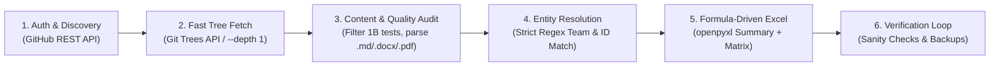

# GitHub Cohort Evaluator — AI-Assisted Academic & Project Auditing

> **Built by [Gautam Gupta](https://www.linkedin.com/in/higautam/)**  
> *An automated, deterministic pipeline for auditing GitHub organization repositories, quantifying weekly class reflections, and generating formula-driven grading workbooks in under 10 seconds.*

---

## Why I Built This

During my MBA course (*Management of AI Products*), our professor needed to evaluate **90 students** across **~40 GitHub repositories**, **700+ weekly class reflection files**, and **multiple live presentation sessions**—and then map everything cleanly into an Excel grading workbook.

Doing this manually in a browser takes hours and is error-prone. Asking an AI to "browse the links and count files" is also unreliable because LLMs hallucinate counts when they can't see private repos or recursive directory trees.

Instead, I built this **deterministic, AI-orchestrated evaluation pipeline**:
1. **Use AI to write & run verifiable scripts**, never to guess counts from memory.
2. **Pull entire repository trees in one API call** (Git Trees API / shallow `git clone --depth 1`) to avoid rate limits.
3. **Normalize messy human submissions** (duplicate `.md`/`.docx` pairs, date-named files, consolidated multi-class files, 1-byte `test` placeholders, and substring team ID collisions).
4. **Output a decision-ready Excel workbook** with an `Executive Summary & Metrics` tab, a `Class 1–12` binary matrix, and live Excel formulas (`=ROUND((Count/12)*10, 2)`).

Anyone—**professors, teaching assistants, hackathon organizers, or engineering managers**—can clone this repository and run it on their own GitHub organization.

---

## Pipeline Architecture



---

## Repository Structure

```text
github-cohort-evaluator/
├── README.md                          # Architecture, origin story & quickstart
├── requirements.txt                   # Minimal Python dependencies (openpyxl)
├── .env.example                       # Environment variable template (never commit .env!)
├── .gitignore                         # Ignores secrets, caches, and private rosters
├── docs/
│   └── GitHub_AI_Evaluation_Playbook.pdf  # Visual step-by-step guide & prompt blueprint
├── src/
│   ├── discover_org.py                # Step 1: Audit org repos & teams via GitHub API
│   ├── audit_reflections.py           # Step 2: Inspect reflections repo (Classes 1..12)
│   └── build_grading_sheet.py         # Step 3: Build multi-tab Excel workbook with formulas
└── examples/
    ├── sample_roster.csv              # Synthetic 10-student demo roster (zero real PII)
    ├── sample_reflections_audit.json  # Synthetic reflection audit output
    └── sample_output.xlsx             # Generated demo grading workbook
```

---

## Quickstart

### 1. Install Dependencies
```bash
pip install -r requirements.txt
```

### 2. Run on the Included Synthetic Demo (No GitHub Token Needed)
```bash
python3 src/build_grading_sheet.py \
  --roster examples/sample_roster.csv \
  --audit examples/sample_reflections_audit.json \
  --output examples/sample_output.xlsx
```

### 3. Run Against Your Own GitHub Organization
Create a GitHub Personal Access Token (`repo` + `read:org` scopes) and export it in your shell (**never hardcode tokens in code**):
```bash
export GH_TOKEN="your_github_pat_here"

# Step 1: Discover all project repositories and teams in the org
python3 src/discover_org.py --org YOUR_ORG_NAME --out org_audit.json

# Step 2: Audit a central Class-Reflections repository (Classes 1..12)
python3 src/audit_reflections.py --repo YOUR_ORG_NAME/Class-Reflections --out reflections_audit.json

# Step 3: Build the formatted, formula-driven Excel grading workbook
python3 src/build_grading_sheet.py \
  --roster your_roster.csv \
  --audit reflections_audit.json \
  --output Final_Grading_Workbook.xlsx
```

---

## Real-World Edge Cases Solved

| Edge Case | Naive Failure | Fix Implemented |
| :--- | :--- | :--- |
| **Substring Team Collisions** | `"TEAM001"` matches `"TEAM0010"` and `"TEAM0015"` | Strict regex `r'TEAM[_-]?0*([0-9]+)'` normalization |
| **1-Byte Placeholder Files** | Empty `test` or `README.md` files counted as valid | Enforce byte size `> 15 B` and word count `>= 15` |
| **Date-Named & Consolidated Files** | `2026-07-25.md` or 1 large `.docx` scores as `0` or `1` | Date-to-class map + `.docx` XML & `.md` heading parser |
| **Duplicate Format Pairs** | Uploading both `.md` and `.docx` inflates count | Track a `set()` of unique class numbers `{1..12}` |
| **Trailing Blank Excel Rows** | Formatted empty rows inflate `COUNTIF` totals | Filter strictly on non-empty student identifiers |

---

## Security & Privacy

* **Zero Secrets:** All scripts read `GH_TOKEN` from environment variables. `.env` is gitignored.
* **Zero PII:** All real student names, university emails, and private org URLs are excluded from this public repository. Only synthetic demo data is included in `examples/`.

---

## Author & Connect

**Gautam Gupta**  
* Product & AI Systems Builder  
* LinkedIn: [https://www.linkedin.com/in/higautam/](https://www.linkedin.com/in/higautam/)  
* GitHub: [@gautamxai](https://github.com/gautamxai)
